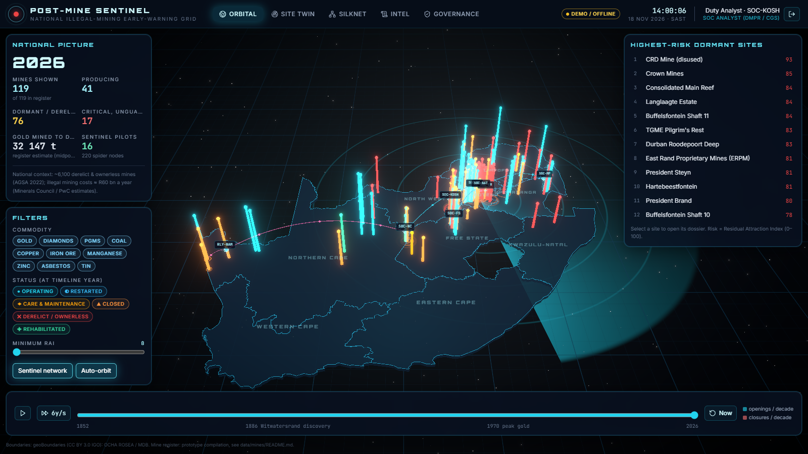
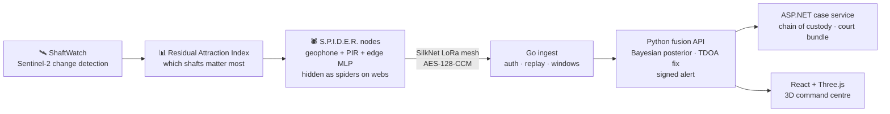
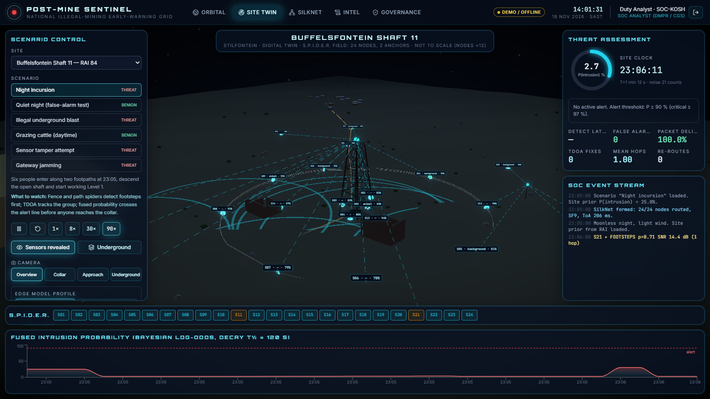
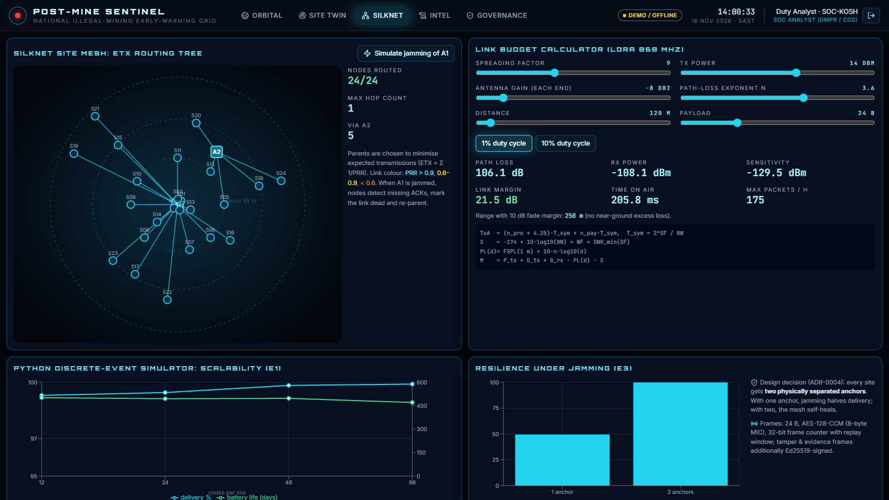
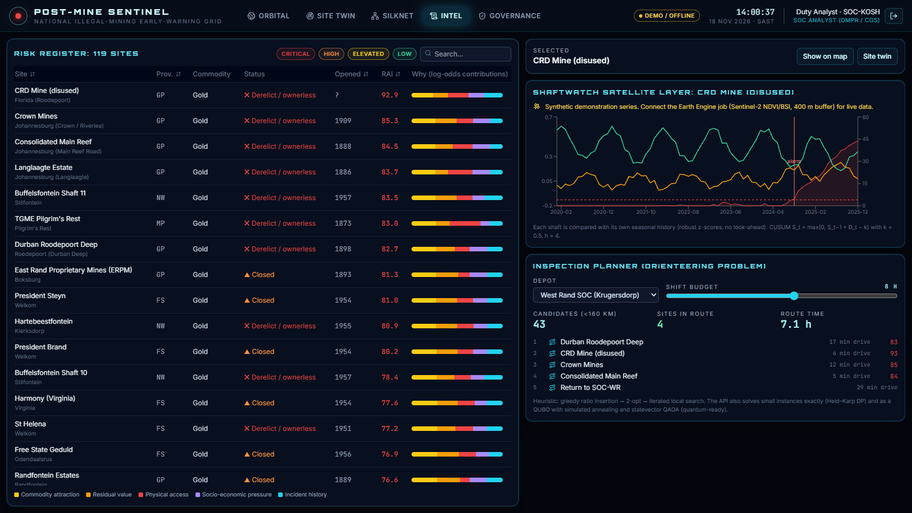
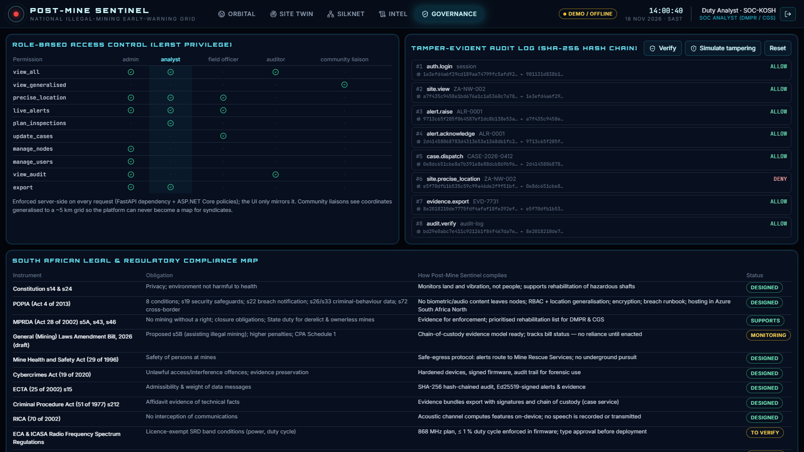

<div align="center">

# 🕷️ Post-Mine Sentinel

**A national early-warning grid against illegal mining at South Africa's derelict mines.**
Satellite risk triage · concealed "spider" sensors with on-device AI · a self-healing radio mesh · Bayesian fusion · court-ready evidence · a 3D command centre.



</div>

---

## Why

South Africa has **≈ 6,100 derelict and ownerless mines**. The Auditor-General found that the State rehabilitates about **2 a year**, that **none of 2,322 high-risk mines** had been rehabilitated, and that the register contained **duplicate GPS coordinates**. People die at sites the State already knows about: the **Stilfontein** standoff ended in January 2025 with **78 bodies and 246 survivors** recovered from Buffelsfontein Shaft 11, and in **July 2026 two SANDF paratroopers died** after falling into an open shaft at the disused CRD Mine. Illegal mining is estimated to cost the economy **≈ R60 billion a year**.

The problem is not knowing *where* the shafts are. It is knowing **which are active right now**, early enough to act safely. → [Full problem statement](docs/01-problem-statement.md) · [Research and international precedents](docs/02-research-and-precedents.md)

## What it does



1. **Prioritise:** an explainable risk model ranks every mine (commodity × residual value × access × socio-economic pressure × incident history), backed by free satellite change detection.
2. **Detect:** concealed sensors modelled on the golden orb-web spider (the **web is the antenna**, the **legs couple vibration**) classify footsteps, digging, drilling, vehicles, animals and blasts **on-device** with a 5.6 KB neural network.
3. **Communicate:** **SilkNet**, our own multi-hop LoRa mesh with per-node encryption, replay protection, duty-cycle compliance and **dual anchors that survive jamming**.
4. **Decide:** per-site Bayesian fusion turns noisy votes into one calibrated probability; seismic TDOA locates the source; alerts are Ed25519-signed.
5. **Respond safely and accountably:** an audited alert lifecycle opens a case with a hash-chained chain of custody and an evidence bundle prepared for **CPA s212 / ECTA s15**. Safety first, not manhunts.

## See it

| Site digital twin: sensors revealed, mesh and detections | SilkNet: routing tree, link budget, jamming resilience |
|---|---|
|  |  |
| **Explainable risk register, ShaftWatch and inspection planner** | **Governance: RBAC, tamper-evident audit chain, SA law map** |
|  |  |

## Results (reproducible: every number is generated by code in this repo)

| Area | Result |
|---|---|
| Edge classifier (MLP, 1,393 params, 1,296 MAC) | Macro-F1 **0.929**, threat AUC **0.992**, **95.4 %** detection at a **2.2 %** false-alarm rate, ECE 0.016 |
| Honest domain-shift test (unseen soil) | Macro-F1 0.745, false alarms 11.8 % → motivates the site-commissioning phase |
| Site twin, 480 simulated runs (40 seeds × 6 scenarios × 2 profiles) | **160/160 intrusions detected**, median **44–47 s**; **0/80** false-alarm runs (calibrated) |
| SilkNet discrete-event simulation | **99.3–99.9 %** delivery; jamming one anchor: **49 % → 99.8 %** with dual anchors; ≈ **500-day** battery life |
| Risk model | Expert RAI AUC **0.80** against reported incidents (learned LOO 0.76) |
| Data quality | The register validator caught **3 province-boundary errors** (the class of error the AG found) |

## Built with (and why)

| Layer | Stack |
|---|---|
| **3D command centre** | React 18 · TypeScript (strict) · Vite · **Three.js / react-three-fiber** · postprocessing (bloom) · Zustand · Recharts · Tailwind |
| **Core API** | **Python 3.12 · FastAPI** · SQLAlchemy 2 · Pydantic v2 · Alembic · Argon2id · JWT · Ed25519 · Prometheus |
| **Case and evidence service** | **C# · ASP.NET Core 10** · EF Core · Npgsql · ProblemDetails · xUnit · WebApplicationFactory |
| **Ingest** | **Go 1.23**, standard library only: hand-written MQTT 3.1.1 client, AES-CCM, RFC 4303 anti-replay |
| **Firmware** | **C++17** · ESP32-S3 + SX1262 · FreeRTOS · RadioLib · Unity tests · STM32WL production path |
| **ML and maths** | NumPy · SciPy · scikit-learn · Bayesian fusion · Levenberg–Marquardt TDOA · CUSUM · orienteering DP · **QUBO + statevector QAOA** |
| **Data** | **PostgreSQL 16 + PostGIS + TimescaleDB** (hypertables, compression, retention, continuous aggregates, immutable audit trigger) |
| **DevOps** | Docker (distroless, chiseled, non-root) · **Kubernetes/AKS** (Kustomize, PSA restricted, NetworkPolicies, HPA) · **Terraform (Azure South Africa North)** · **GitHub Actions** CI/CD · CodeQL · Trivy · gitleaks · SBOM + SLSA provenance · cosign · Prometheus/Grafana |

## Quick start

**1. The 3D console in offline demo mode** (Node 20, about 2 minutes):
```bash
cd apps/command-center
npm ci
npm run dev        # → http://localhost:5173, choose a demo role, explore
```

**2. Run the tests that matter locally:**
```bash
python -m venv .venv && .venv/Scripts/pip install -e "ml[dev]" -e "services/api[dev]"   # Windows path shown
(cd ml && ../.venv/Scripts/python -m pytest)
(cd services/api && ../../.venv/Scripts/python -m pytest)
(cd services/case-service && dotnet test)
(cd apps/command-center && npm test)
```
Windows shortcut: `.\scripts\dev.ps1 setup`, then `.\scripts\dev.ps1 test`. Linux/macOS: `make setup test`.

**3. The full stack** (Docker), including the field simulator sending real encrypted SilkNet frames:
```bash
cp infra/.env.example infra/.env       # set the secrets
docker compose -f infra/docker-compose.yml --env-file infra/.env up --build
docker compose -f infra/docker-compose.yml --env-file infra/.env --profile demo run --rm fieldsim
# console :8080 · API docs :8000/docs · case service :8081 · Grafana :3000
```

## Repository map

```
apps/command-center/   3D command centre + deterministic site simulation engine (TS)
services/api/          FastAPI core: register, fusion, alerts, planning, audit (+ Alembic)
services/case-service/ ASP.NET Core 10 case & evidence service (domain, API, tests)
services/ingest/       Go MQTT → SilkNet → window batches (stdlib only)
firmware/spider-node/  C++ node firmware: DSP, MLP, SilkNet, FreeRTOS app, Unity tests
ml/                    signals, features, edge training/export, fusion, TDOA, risk, satellite, planning, netsim
protocol/              SilkNet spec, Python reference, cross-language test vectors
data/                  validated mine register, provinces, national network design
infra/                 docker compose, k8s (Kustomize), Terraform (Azure), observability
docs/                  problem, research, SRS, architecture, DB, security, legal, HCI, maths, ML, network,
                       hardware, testing, DevOps, error handling, business case, ADRs, policies
```

## Engineering principles

Every significant decision is recorded as an [ADR](docs/adr/README.md). Cross-language behaviour is pinned by **shared test vectors** (protocol: Python ⇄ Go ⇄ C++; ML: Python ⇄ C++). Errors follow one contract: RFC 7807 Problem Details with trace IDs, retries with jittered back-off, circuit breakers, dead-letter queues, and firmware watchdogs and safe mode ([docs/15](docs/15-error-handling.md)). Security is designed with STRIDE and mapped to ISO 27001 and NIST CSF 2.0 ([docs/06](docs/06-information-security.md)). Compliance covers POPIA, MPRDA and the 2025–2026 bills, ECTA, the CPA, RICA, ICASA and PSIRA ([docs/07](docs/07-legal-and-regulatory.md)).

## Status and honesty

This is a **prototype and pitch-ready reference implementation**, not a deployed system.
* Models are trained on **physics-informed synthetic data** ([ADR-0009](docs/adr/0009-synthetic-bootstrap-data.md)); real accuracy will be known only after the Phase-1 field pilot.
* The mine register is a curated **prototype**: approximate coordinates and low-confidence production ranges, clearly flagged. Use official D&O / SAMINDABA data for operations.
* The Go and C++ test suites are written against the shared vectors and run in CI. Locally verified so far: Python (49 tests), TypeScript (15), .NET (19), browser smoke tests.
* Radio use requires ICASA confirmation and type approval; commercial monitoring requires PSIRA registration.

## Origin

Grew out of the *ShaftWatch ZA* hackathon concept (satellite early warning, risk scoring, QAOA inspection planning, post-quantum security). All four ideas live on here as layers of a larger system.

---
*Licence: not yet chosen. All rights reserved by the author until a licence is added.*
