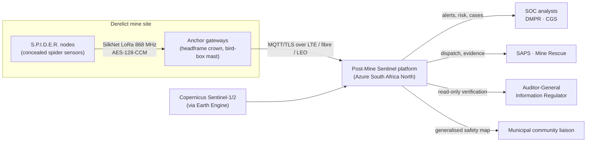
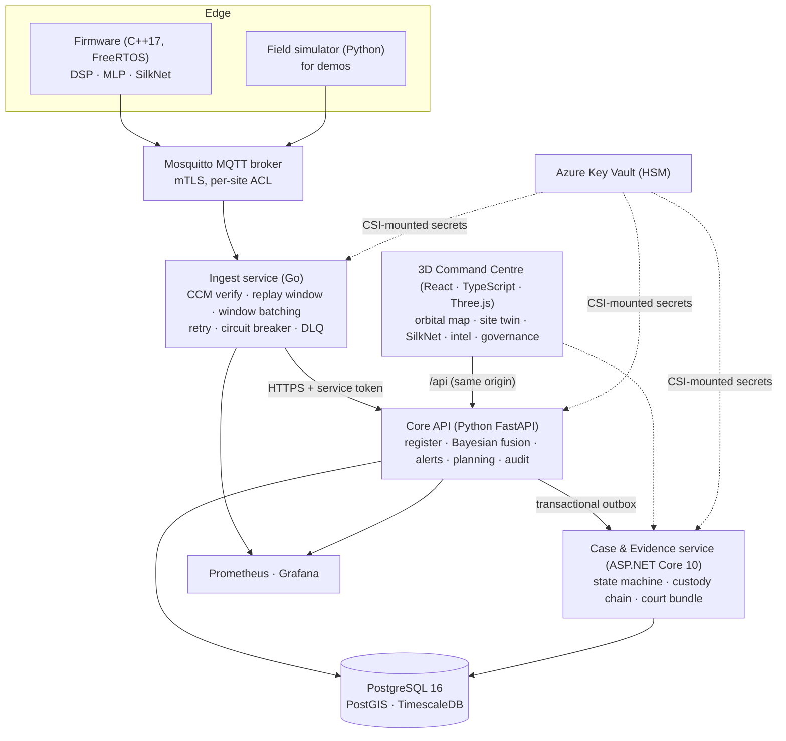
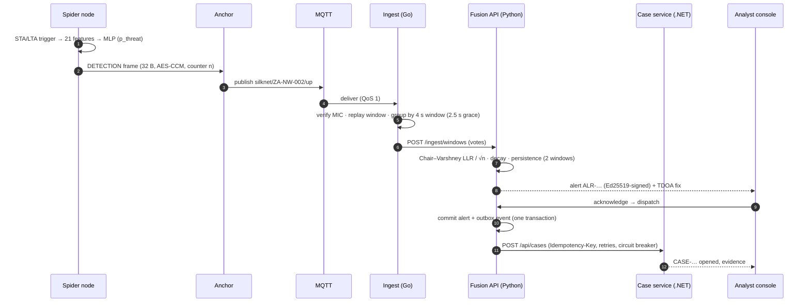

# 4. Architecture

## 4.1 System context (C4 level 1)

## 4.2 Containers (C4 level 2)

| Container | Technology | Why this technology (see ADRs) |
|---|---|---|
| Firmware | C++17, ESP32-S3 + SX1262, FreeRTOS, RadioLib | Deterministic, no heap churn; portable core libraries unit-tested on the host |
| Ingest | Go 1.23, standard library only | High-throughput network service, tiny static binary, no third-party supply chain |
| Core API | Python 3.12, FastAPI, SQLAlchemy 2, Pydantic v2 | Shares the ML/maths package with research code; generates OpenAPI |
| Case service | C# / ASP.NET Core 10, EF Core, Npgsql | Strongly typed enterprise workflow domain; widely used in SA government IT |
| Database | PostgreSQL 16 + PostGIS + TimescaleDB | Relational integrity + spatial queries + time series in one engine |
| Console | React 18, TypeScript, Vite, react-three-fiber, Zustand, Tailwind | GPU-accelerated 3D in the browser; typed simulation engine |
| Platform | Docker, Kubernetes (AKS), Terraform, GitHub Actions | Reproducible, policy-enforced, auditable delivery |

## 4.3 Detection-to-response sequence

## 4.4 Deployment view

* **Local:** `docker compose` (`infra/docker-compose.yml`) runs the full stack, including Grafana, plus a `demo` profile with the field simulator.
* **Cloud:** Terraform (`infra/terraform`) provisions AKS (workload identity, Azure RBAC, network policy), PostgreSQL Flexible Server (zone-redundant, geo-backups to South Africa West), a premium Key Vault, a WORM evidence storage account and Log Analytics, all in **South Africa North**. Kustomize (`infra/k8s`) deploys hardened workloads; GitHub Actions releases signed images (see [14-devops-and-operations.md](14-devops-and-operations.md)).
* **Edge:** anchors back-haul over LTE where coverage exists, fibre at urban sites, and LEO satellite in Namaqualand.

## 4.5 Architecturally significant decisions

| ADR | Decision |
|---|---|
| [0001](adr/0001-polyglot-monorepo.md) | Polyglot monorepo with shared contracts (protocol vectors, golden ML vectors) |
| [0002](adr/0002-silknet-over-lorawan.md) | Private SilkNet mesh on LoRa PHY instead of LoRaWAN star |
| [0003](adr/0003-bayesian-window-fusion.md) | Bayesian log-odds fusion with Chair–Varshney window votes and persistence |
| [0004](adr/0004-dual-anchors.md) | Two physically separated anchors per site |
| [0005](adr/0005-postgres-postgis-timescale.md) | PostgreSQL + PostGIS + TimescaleDB |
| [0006](adr/0006-esp32-prototype-stm32wl-production.md) | ESP32-S3 prototype, STM32WL production node |
| [0007](adr/0007-aspnet-case-service.md) | ASP.NET Core for case and evidence management |
| [0008](adr/0008-azure-south-africa-north.md) | Azure South Africa North hosting |
| [0009](adr/0009-synthetic-bootstrap-data.md) | Physics-informed synthetic data until field data exists |
| [0010](adr/0010-post-quantum-roadmap.md) | Post-quantum migration roadmap |

## 4.6 Quality attributes and tactics

| Attribute | Tactics |
|---|---|
| Availability | Dual anchors; mesh self-healing; HPA and PDB; outbox; DLQ; graceful shutdown that flushes pending windows |
| Security | Defence in depth (see [06](06-information-security.md)); fail-closed decoding; least privilege everywhere |
| Modifiability | Hexagonal boundaries (pure domain/engine modules); contracts shared through vectors, not code |
| Performance | Edge inference reduces radio traffic about 100× compared with streaming audio; per-window batching |
| Testability | Deterministic simulators (seeded); host-runnable firmware cores; golden vectors across languages |
