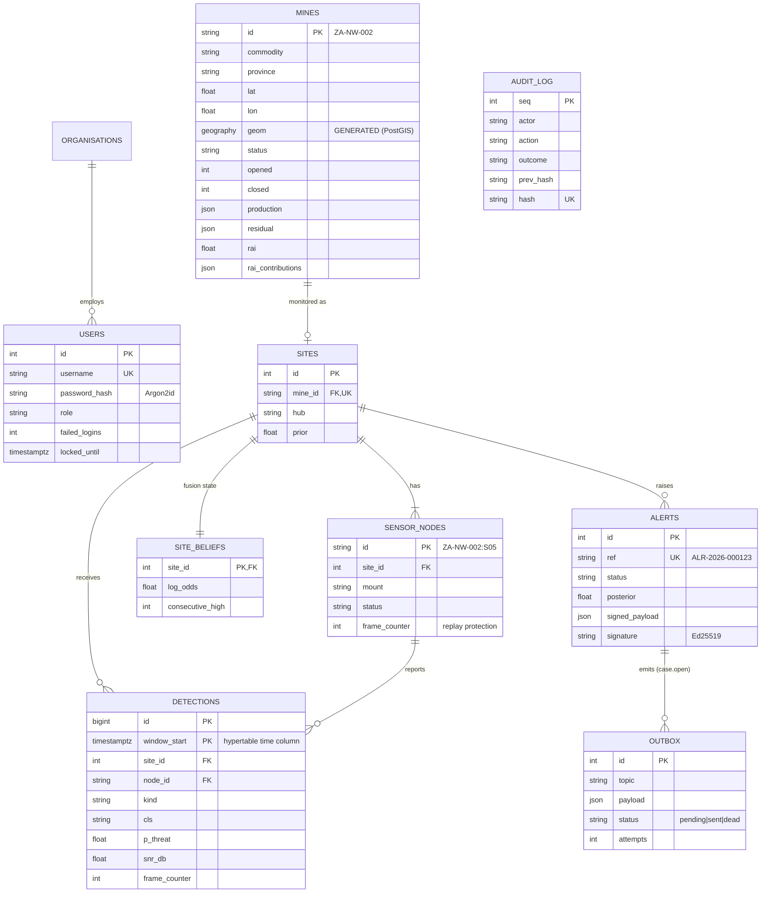

# 5. Database design

Two bounded contexts each own their schema (no shared tables): **sentinel** (register, sensing, fusion, alerts, audit) is owned by the FastAPI service and Alembic; **sentinel_cases** (cases, evidence, custody) is owned by the ASP.NET service and EF Core.

## 5.1 Logical model: sentinel



## 5.2 Normalisation and integrity

* Core entities are in **3NF**: mine attributes depend only on the mine key; site deployment facts live in `sites`; node facts in `sensor_nodes`.
* Deliberate, documented **denormalisations**: `mines.rai_factors` and `rai_contributions` are stored as JSON snapshots of a computed model output, so an analyst can see *the reasons that were shown at the time*. `alerts.signed_payload` stores the exact signed bytes so signatures verify forever.
* Domain constraints are enforced in the database, not only in code: `CHECK` on role and alert-status enums, `CHECK` that coordinates are inside South Africa's bounding box, `UNIQUE (node_id, frame_counter, window_start)` for idempotent ingest, and `UNIQUE alerts.ref`.

## 5.3 PostgreSQL-specific physical design (migration 0001)

| Feature | DDL | Purpose |
|---|---|---|
| Spatial | `geom geography(Point,4326) GENERATED ALWAYS AS (...) STORED` + GiST index | `ST_DWithin` "sites within 50 km of this depot" in milliseconds |
| Time series | `create_hypertable('detections','window_start', chunk_time_interval => 7 days)` | Insert-heavy telemetry; chunk pruning |
| Compression | `add_compression_policy(..., 30 days)`, segmented by `site_id` | ~10× storage reduction on old data |
| Retention | `add_retention_policy(..., 5 years)` | POPIA s14: do not keep data longer than necessary |
| Analytics | Continuous aggregate `site_activity_hourly` | Dashboards without scanning raw votes |
| Immutability | `BEFORE UPDATE OR DELETE OR TRUNCATE` trigger on `audit_log` | Even the application role cannot rewrite history (tested in CI) |

## 5.4 Case database (EF Core)

`cases` (unique `reference`, unique `idempotency_key`, `version` optimistic-concurrency token) → `case_events` (timeline) and `evidence` (digest only; bytes in WORM blob storage) → `custody_transfers` (unique `(evidence_id, sequence)`, `previous_hash` → `hash` chain).

## 5.5 Transactions and concurrency

* **Fusion** takes a row lock on `site_beliefs` (`SELECT … FOR UPDATE`), so concurrent batches for one site serialise across API replicas.
* **Dispatch** writes the alert status change and the `outbox` row in **one transaction** (transactional outbox). The relay delivers *at least once*; the case service de-duplicates on `Idempotency-Key`, so the end-to-end effect is exactly once.
* **Cases** use optimistic concurrency (`version`); a conflict returns `409` ProblemDetails and asks the user to reload.

## 5.6 Example queries

```sql
-- Dormant high-risk sites within 60 km of the KOSH SOC, nearest first
SELECT id, name, rai, ST_Distance(geom, ST_MakePoint(26.6667, -26.8521)::geography) / 1000 AS km
FROM mines
WHERE status IN ('derelict', 'closed') AND rai >= 50
  AND ST_DWithin(geom, ST_MakePoint(26.6667, -26.8521)::geography, 60000)
ORDER BY km;

-- Night-time threat votes per site, last 7 days (continuous aggregate)
SELECT site_id, sum(threat_votes) AS votes
FROM site_activity_hourly
WHERE bucket > now() - interval '7 days' AND extract(hour FROM bucket) NOT BETWEEN 6 AND 18
GROUP BY site_id ORDER BY votes DESC;
```
