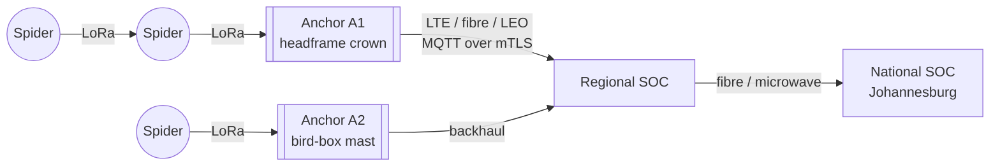

# 11. Network design: SilkNet and the national backbone

Post-Mine Sentinel runs **its own network**, from a 4 cm sensor in a web to a national operations centre.

## 11.1 Layers

| Layer | Choice | Rationale |
|---|---|---|
| PHY | LoRa CSS, 868 MHz, SF9, 125 kHz, CR 4/5 | km-scale links at µW–mW power; robust below the noise floor (−129.5 dBm sensitivity at SF9) |
| MAC | Listen-before-talk (CAD), ALOHA with exponential back-off, hop-by-hop ACK, ≤ 3 retries | Simple, robust, regulatory-friendly |
| Network | **ETX collection tree** to the anchors (RPL/CTP-style), hop limit 7 | Self-healing: a lost parent (theft, jamming) is replaced on missing ACKs |
| Security | AES-128-CCM per-node keys; 32-bit counters; anti-replay window | See [06 §6.4](06-information-security.md#64-cryptographic-inventory) |
| Transport to cloud | MQTT 3.1.1 QoS 1 over TLS (8883, mutual TLS per gateway) | Industry standard for IoT; the broker ACL pins each gateway to `silknet/<site>/up` |
| Application | 32-byte SilkNet frames ([protocol/SILKNET.md](../protocol/SILKNET.md)) | One detection fits in one ≈ 247 ms transmission |

Why not LoRaWAN? See [ADR-0002](adr/0002-silknet-over-lorawan.md): LoRaWAN is a single-hop star. Ground-level concealed nodes behind fences and rocks need **multi-hop relaying** and must keep working when the site's internet link is down.

## 11.2 Link budget (concealed ground nodes)

| Term | Value |
|---|---|
| TX power | 14 dBm |
| Antenna gain (web spiral, each end) | −8 dBi (small and inefficient: a conservative assumption) |
| Near-ground excess loss (Fresnel obstruction, grass) | 22 dB |
| Path-loss exponent | 3.6 |
| Sensitivity SF9/125 kHz (NF 6 dB) | −129.5 dBm |
| **Node ↔ node range** (PRR 0.5) | **≈ 90 m** |
| **Node ↔ headframe anchor** (+12 dB height gain) | **≈ 190 m** |

Hence the layout: the **headframe crown is the best antenna mast on any derelict site** (≈ 30 m high). The second anchor sits on a separate mast so one jammer cannot cover both.

## 11.3 Simulation results (`ml/scripts/run_netsim.py`)

| Experiment | Result |
|---|---|
| E1, 12 → 96 nodes, busy night (4 events/node/h) | PDR **99.3–99.9 %**, p95 latency ≈ 1.0–1.4 s, battery ≈ **470–520 days** |
| E2, spreading factor trade-off (24-byte frame) | SF7: 62 ms on air, 583 frames/h within 1 % duty cycle, ≈ 2.4 km free-field range · SF9: 206 ms, 175 frames/h, ≈ 3.5 km · SF12: 1.48 s, 24 frames/h, ≈ 6.2 km |
| E3, jamming the primary anchor at 6 h | **1 anchor: 49.4 % PDR · 2 anchors: 99.8 % PDR** → [ADR-0004](adr/0004-dual-anchors.md) |

The browser twin runs the same propagation and ETX model live: in the *Gateway jamming* scenario the routing tree visibly re-parents to A2.

## 11.4 National backbone

Six Sentinel Operations Centres (Krugersdorp, Boksburg, Klerksdorp, Welkom, Kimberley, Mbombela), a Namaqualand LEO-satellite relay (Springbok) and the national SOC in Johannesburg (`data/network/sentinel_network.json`). Phase-1 pilots: 16 sites, **220 spider nodes, 22 anchors**.

## 11.5 Regulatory notes

The prototype targets 868 MHz SRD conditions with a firmware-enforced 1 % duty cycle (`silknet::DutyCycle`) and LBT. The applicable ICASA Radio Frequency Spectrum Regulations / National Radio Frequency Plan entry and conditions **must be confirmed, and type approval obtained, before field deployment** ([07 §7.4](07-legal-and-regulatory.md#74-communications-cyber-and-evidence-law)).
