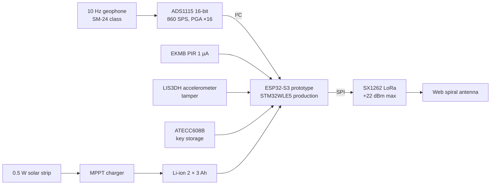

# 12. Embedded hardware: the S.P.I.D.E.R. node

**S**eismic & **P**assive-**I**nfrared **D**etection, **E**dge **R**elay: a sensor disguised as a spider on its web.

## 12.1 Biomimetic concealment

The form is modelled on South Africa's **golden orb-web spider** (*Trichonephila* spp.). It builds large, long-lived webs across exactly the structures found at shaft heads: headframe lattices, fences, ruins and rock crevices. Nobody looks twice at a spider web on an abandoned headframe, and people avoid touching them.

| Spider part | Engineering function |
|---|---|
| **Web** | The radial threads and capture spiral are a **printed/wire spiral antenna** for 868 MHz (λ/4 ≈ 8.6 cm) with its ground-plane radials, at a conservative −8 dBi efficiency |
| **Legs** | Stainless coupling spikes press the body against steel or rock, mechanically coupling vibration into the sensor |
| **Abdomen** | MCU + radio, energy storage and secure element |
| **Cephalothorax "eyes"** | Fresnel window for the low-power PIR |
| Ground "rock" (fence and path nodes) | Hollow resin rock holding the geophone spike, the larger cell and a solar strip |

The console's **Plain sight / Sensors revealed** toggle demonstrates the idea in the 3D twin.

## 12.2 Block diagram

## 12.3 Bill of materials (prototype, indicative ZAR prices, 2026)

| Item | Part | Qty | ≈ ZAR |
|---|---|---|---|
| MCU + LoRa module | Heltec WiFi LoRa 32 V3 (ESP32-S3 + SX1262) | 1 | 450 |
| Seismic sensor | 10 Hz geophone element (SM-24 class) | 1 | 1,300 |
| ADC | ADS1115 breakout | 1 | 120 |
| Tamper sensor | LIS3DH breakout | 1 | 80 |
| PIR | Low-power dual-element PIR with **pet-immune** optics (ignores animals < ~25 kg) | 1 | 280 |
| Energy | 2 × 18650 Li-ion (6 Ah) + MPPT charger + 0.5 W panel | 1 | 450 |
| Secure element | ATECC608B | 1 | 40 |
| Enclosure | 3D-printed ASA spider body + resin rock, UV-stable paint, conformal coating | 1 | 250 |
| Antenna and misc | Web spiral, spikes, connectors | 1 | 210 |
| **Total (prototype)** | | | **≈ R3,180** |

**Production target (ADR-0006):** STM32WLE5 SoC (MCU and LoRa on one die), a MEMS/piezo seismic front end and a custom 30 × 22 mm PCB. Target **≈ R1,200 per node at 1,000 units**. An **anchor gateway** (Raspberry Pi CM4 + SX1302 8-channel concentrator + LTE modem + 50 W solar + LiFePO₄ in a weathered "bird-box" housing) costs ≈ R9,000. A typical site (24 spiders + 2 anchors) is ≈ **R90k as a prototype and ≈ R47k in production**.

## 12.4 Firmware architecture (`firmware/spider-node`)

| Task (FreeRTOS) | Priority | Responsibility |
|---|---|---|
| `sampler` | 5 | 500 Hz ADC sampling into a double buffer; saturation flag |
| `radio` | 4 | LBT (CAD), duty-cycle budget, ACK/retry with back-off, ETX parent, store-and-forward |
| `dsp` | 3 | STA/LTA trigger → 21 features → MLP → DETECTION / BENIGN frames; PIR fusion |
| `tamper` | 2 | Accelerometer orientation change → signed last-gasp TAMPER frame (jumps the queue) |
| `heartbeat` | 1 | Liveness, battery and status bits every 5 minutes |

**Reliability features:** an 8 s task watchdog on every task; crash-loop detection (3 abnormal resets → **safe mode**, heartbeats only); refusal to transmit without a provisioned key; frame counters **reserved ahead in flash in blocks of 64** (never reused across power loss, ~64× less flash wear); and a static 66 KB DSP workspace (no heap, no stack overflow).

## 12.5 Power budget

| State | Current | Duty | Average |
|---|---|---|---|
| Sampling + DSP (ESP32-S3, light sleep between samples) | ≈ 0.30 mA avg (production STM32WL) | continuous | 0.30 mA |
| Radio TX at 14 dBm | 45 mA | ≈ 0.1 % (busy night) | 0.05 mA |
| Radio RX windows (relay, ACKs) | 5 mA | 2 % | 0.10 mA |
| **Total** | | | **≈ 0.45 mA → ≈ 500 days on 6 Ah** before solar harvest |

The ESP32-S3 prototype draws far more (~20–40 mA with sampling); it is for validation, not deployment. That is why ADR-0006 moves production to the STM32WL.

## 12.6 Deployment SOP (summary)

See [policies/device-deployment-sop.md](policies/device-deployment-sop.md): two-person teams, never alone and never at night; no entry into workings; GPS survey of each node position (for TDOA); a 48-hour commissioning period to learn the background; photo-document the concealment; record each device's serial number and key ID in the asset register.
