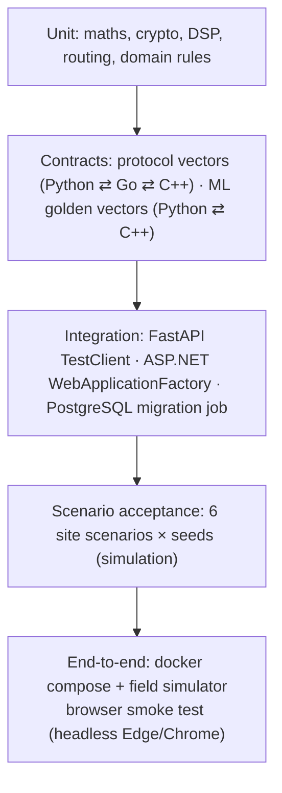

# 13. Testing and quality assurance

## 13.1 Strategy

A test pyramid per component, plus **cross-language contract tests**, which matter most in a polyglot system:



## 13.2 Inventory and status

| Component | Framework | Tests | Status in this repository |
|---|---|---|---|
| ML / analytics | pytest | 25 | ✅ passing locally (ruff clean) |
| Simulation engine + maths (TS) | Vitest | 15 (incl. 7 scenario acceptance tests) | ✅ passing locally |
| 3D console | ESLint, `tsc` strict, Vite build, Playwright-core smoke | 5 pages + 2 interactions | ✅ zero browser console errors (headless Edge) |
| Core API | pytest + TestClient | 24 | ✅ passing locally (ruff clean) |
| Case service | xUnit + WebApplicationFactory | 19 | ✅ passing locally (warnings as errors) |
| Ingest (Go) | `go test -race` | 17 | ⚠️ written against shared vectors; **compiled and run in CI** (Go toolchain not available on the authoring machine) |
| Firmware (C++) | Unity via PlatformIO `native` | 15 | ⚠️ written against shared vectors; **compiled and run in CI** (no host C++ compiler on the authoring machine) |
| PostgreSQL DDL | Alembic on TimescaleDB-HA in CI | migration + immutability check | ⚠️ CI only (SQLite path verified locally) |

## 13.3 Scenario benchmark (40 seeds × 6 scenarios × 2 model profiles = 480 runs)

| Profile | Threat scenarios detected | Mean detection latency | False alarms in benign scenarios | Mean PDR |
|---|---|---|---|---|
| **Calibrated** | **160 / 160** | median 44–47 s, p90 ≤ 64 s (blast: ≈ 10 s after detonation) | **0 / 80 runs** | ≈ 99.1 % |
| Uncalibrated (unseen soil) | 150 / 160 (10 blasts missed) | median 50–69 s, p90 ≤ 91 s | 1 / 80 runs (quiet night) | ≈ 99.1 % |

## 13.4 Defects found by the tests (and fixed)

| Defect | Found by | Fix |
|---|---|---|
| Blast signals physically too weak (soil attenuation applied to rock body waves) | `test_blast_is_more_impulsive_than_background` | Body-wave propagation model; blast recall 0.71 → 1.00 |
| Province mismatch for 3 mines on the Vaal / Steelpoort boundaries | Register point-in-polygon validation | Provinces reassigned from authoritative geometry, with notes |
| QUBO penalty distorted feasible optima with continuous costs | Review + `test_qubo_ground_state_is_optimal_knapsack` | Integer slack scaling, $P=\sum r_i+1$ |
| Correlated cattle votes caused false alarms once negative evidence was bounded | Scenario tests | Chair–Varshney window votes + √n + persistence |
| Jackal at the collar: rare seismic misclassification *and* PIR trigger (correlated evidence), 1/40 quiet nights | 40-seed benchmark | Pet-immune PIR specification; PIR corroborates gait votes only |
| EF Core treated new evidence (client-generated GUID key) as an UPDATE → 409 | `Full_workflow_…` xUnit test | `ValueGeneratedNever()` on client-keyed entities |
| Login rate limiter tripped by the test suite itself | API tests (429) | Per-test limiter isolation + an explicit rate-limit test |
| nginx `add_header` inheritance would drop CSP/HSTS on `/` and `/assets/` | Code review | Shared header snippet included per location |
| GLSL `smoothstep(edge0 > edge1)` undefined behaviour | Code review | Rewritten as `1 - smoothstep(...)` |

## 13.5 Quality gates (CI)

Every pull request must pass: lint (ruff, ESLint, gofmt/vet, `-warnaserror`), types (`tsc --strict`, C# nullable), unit, contract and integration tests, browser smoke, IaC validation, a container build, CodeQL, Trivy, gitleaks and dependency review. Releases additionally block on **critical CVEs in the built image**.

## 13.6 Running everything locally

```bash
# Python (ML + API)
python -m venv .venv && .venv/bin/pip install -e ml -e "services/api[dev]"
(cd ml && pytest) && (cd services/api && pytest)
# TypeScript
(cd apps/command-center && npm ci && npm run lint && npm run typecheck && npm test && npm run build)
# .NET
(cd services/case-service && dotnet test)
# Go + firmware
(cd services/ingest && go test -race ./...)
(cd firmware/spider-node && pio test -e native)
```
