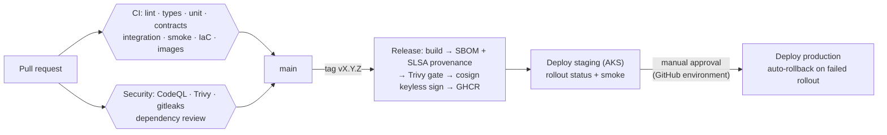

# 14. DevOps and operations

## 14.1 Delivery pipeline

| Workflow | File |
|---|---|
| Continuous integration (10 jobs) | `.github/workflows/ci.yml` |
| Security scanning (weekly re-scan) | `.github/workflows/security.yml` |
| Release and continuous deployment | `.github/workflows/release.yml` |
| Dependency updates (npm, pip, NuGet, Go, Docker, Terraform, Actions) | `.github/dependabot.yml` |

## 14.2 Environments

| Environment | Where | Data | Purpose |
|---|---|---|---|
| Demo | Browser only (`npm run dev`) | Bundled register + simulation | Pitches, teaching, usability tests |
| Local | `docker compose` | Seeded demo users, field simulator | Development, end-to-end tests |
| Staging | AKS, South Africa North | Synthetic + pilot data | Release verification |
| Production | AKS, South Africa North (zone-redundant) | Live | Operations |

## 14.3 Infrastructure as code

* **Terraform** (`infra/terraform`): network, AKS (OIDC + workload identity, Azure RBAC, no local accounts, Azure Policy), PostgreSQL Flexible Server 16 (private, zone-redundant HA in prod, 35-day PITR, geo-backup), Key Vault Premium (HSM, purge protection, network-restricted), WORM evidence storage (7-year immutability), Log Analytics. State lives in a remote, locked backend.
* **Kustomize** (`infra/k8s`): restricted Pod Security, non-root, read-only filesystems, dropped capabilities, seccomp, default-deny NetworkPolicies, HPA, PDBs, topology spread, probes, and Key Vault secrets via the CSI driver.

## 14.4 Observability

* **Logs:** structured JSON everywhere (FastAPI middleware, ASP.NET JSON console, Go `slog`, client-side error logs) carrying a **request/trace ID** that is returned in every RFC 7807 error.
* **Metrics:** Prometheus (`/api/v1/metrics`, ingest `:9102/metrics`) with Grafana dashboard `sentinel-ops`.
* **Alerts:** `infra/observability/alerts.yml`: auth-failure spike, replay attempts, login bursts, dead letters, circuit open, silent site, target down.

## 14.5 Service level objectives

| SLO | Target | Error budget (30 d) |
|---|---|---|
| Alert pipeline availability (ingest → fusion) | 99.9 % | 43 min |
| Detection-to-alert latency p95 (cloud portion) | < 5 s | n/a |
| Console availability | 99.5 % | 3.6 h |
| Evidence durability | 11 nines (ZRS + WORM) | n/a |

## 14.6 Runbooks

**RB-1 SilkNet authentication failures spike.** 1) Identify the site and node from ingest logs (`frames_auth_failed` by gateway). 2) If one node: suspect a cloned or replayed device; mark it `suspect`, schedule a physical check. 3) If one site, many nodes: suspect a rogue transmitter; raise a security incident (IRP §3) and notify the regional SOC. 4) Never rotate keys from a field laptop; use the Key Vault rotation pipeline.

**RB-2 Batches dead-lettered.** 1) Check `IngestCircuitOpen` and API readiness. 2) Fix the root cause (DB, API rollout). 3) Replay the DLQ: `jq -c .batch dead-letter.jsonl | xargs -I{} curl -H "X-Service-Token: …" -d '{}' $API/ingest/windows` (idempotent: duplicates are rejected by the replay window and unique constraints). 4) Record the gap in the incident log (evidence continuity).

**RB-3 Site silent for 30 min.** Check backhaul (LTE signal, power) via the anchor heartbeat; check whether *both* anchors are silent (possible jamming or theft, which is itself evidence). Dispatch a maintenance team in daylight with two people (SOP).

**RB-4 Database failover.** Zone-redundant HA fails over automatically; the API's `pool_pre_ping` and Npgsql `EnableRetryOnFailure` absorb it. Verify with `/api/v1/ready` and `/health/ready`.

## 14.7 Backup and disaster recovery

RPO ≤ 5 min (PITR), RTO ≤ 1 h (IaC rebuild + restore). Restores are tested quarterly into staging. Evidence lives in immutable storage. The audit log is exported nightly to WORM storage.

## 14.8 Developer experience

`Makefile` (Linux/macOS/CI) and `scripts/dev.ps1` (Windows) wrap common tasks. Pre-commit hooks (`.pre-commit-config.yaml`) run ruff, ESLint, gofmt and gitleaks before code leaves a laptop.
